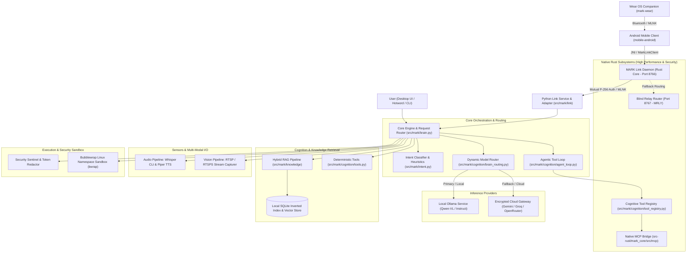

# MARK: Modular Augmented Reasoning & Knowledge Assistant

## 1. Project Overview

MARK (Modular Augmented Reasoning & Knowledge Assistant) is an open-source, privacy-first personal AI assistant and cognitive platform designed for local-first computing environments. MARK integrates local vision-language inference, deterministic knowledge retrieval, voice and vision processing, sandboxed tool execution, a native Model Context Protocol (MCP) bridge in Rust, a resilient private transport mesh (MARK Link), and multi-device interaction across desktop, mobile, and wearable interfaces.

The software functions as an orchestration, routing, and cognitive runtime that coordinates specialized system services, hardware sensors, and neural model runtimes without binding the user to proprietary remote ecosystems or compromising confidential host data.

An exhaustive technical treatise is published alongside this document at [`MARK_ENGINEERING_OVERVIEW.pdf`](MARK_ENGINEERING_OVERVIEW.pdf) (also accessible as [`engineer.pdf`](engineer.pdf)) in the repository root. A comprehensive log of recent architectural enhancements is available at [`updates.md`](updates.md).

---

## 2. Objectives and Design Philosophy

MARK is engineered around six fundamental principles:

1. **Local-First Computation**: Execution defaults to host-managed local runtimes (such as Ollama and local speech engines) to ensure data confidentiality and offline availability.
2. **Strict Boundary Defense**: Kernel-level isolation using Bubblewrap (`bwrap`) namespaces and Linux cgroups prevents untrusted or experimental code execution from accessing personal files, credentials, or network interfaces.
3. **Deterministic Tool Grounding**: High-precision tasks (such as unit conversion, chemistry calculations, and structured data queries) are delegated to deterministic, mathematically verified tools rather than generative language model approximations.
4. **Context Integrity and Injection Defense**: Retrieved knowledge chunks and external content are strictly encapsulated in untrusted boundary tags (`<untrusted_content>`) and sanitized before context injection.
5. **Native Capability-Isolated MCP Bridge**: External tools are orchestrated through a native Rust Model Context Protocol (MCP) subsystem enforcing physical memory quotas (anti-OOM), canonical path normalization (anti-traversal), and zero-trust capability tiers (`ReadOnly`, `WriteMutate`, `NetworkAccess`).
6. **Resilient Zero-Trust Device Federation (MARK Link)**: Workstations, Android phones, and Wear OS companions communicate over an autonomous, encrypted peer-to-peer and relay-assisted mesh featuring mutual P-256 ECDSA authentication, transcript signatures, directional AES-256-GCM channels, request idempotency, and adaptive keep-alives.

---

## 3. High-Level Architecture

MARK is structured as a modular layered architecture comprising core Python orchestration libraries, high-performance Rust subsystems (`mark_core` and `mark_link`), a PyQt6 desktop workstation interface, systemd user services, and mobile/wearable companion applications connected via native JNI.



---

## 4. Major Subsystems and Responsibilities

| Subsystem | Primary Modules | Responsibility | Implementation Status |
| :--- | :--- | :--- | :--- |
| **Core Brain & Router** | `src/mark/brain.py`, `src/mark/cognition/agent_loop.py` | Request orchestration, intent routing, context formatting, multi-turn session lifecycle. | `IMPLEMENTED`, `VERIFIED` |
| **MARK Link (Transport & Mesh)** | `src-rust/mark_link/`, `src/mark/link/` | Resilient P2P network daemon, mutual P-256 handshake, directional AES-256-GCM framing, failover, blind relay router. | `IMPLEMENTED`, `VERIFIED` |
| **Native MCP Bridge** | `src-rust/mark_core/src/mcp/` | Rust-native Model Context Protocol engine, zero-trust capability separation, memory quotas, path normalization. | `IMPLEMENTED`, `VERIFIED` |
| **Cognition & Hybrid RAG** | `src/mark/knowledge/`, `src/mark/cognition/` | Document ingestion, chunking, inverted-index lexical retrieval, source citation, scoped memory. | `IMPLEMENTED`, `TESTED` |
| **Deterministic Tools** | `src/mark/cognition/tools.py`, `chemistry.py` | Mathematical unit conversion, molar mass calculation, verified computation. | `IMPLEMENTED`, `TESTED` |
| **Audio Processing** | `src/mark/audio.py`, `src/mark/tts.py` | VAD recording, dual-model Whisper STT, Piper ONNX / eSpeak-ng dual-voice synthesis. | `IMPLEMENTED`, `TESTED` |
| **Vision Acquisition** | `src/mark/vision.py`, `src/mark/vision_live.py` | RTSP/RTSPS frame acquisition, validation, resizing, base64 payload preparation. | `IMPLEMENTED`, `TESTED` |
| **Cryptographic Vault** | `src/mark/provider_settings.py`, `src/mark/pki.py` | AES-256-GCM keystore for external API tokens; device identity authentication. | `IMPLEMENTED`, `TESTED` |
| **Process Sandboxing** | `src/mark/sandbox.py`, `src/mark/evolution/sandbox.py` | Kernel-level unshare, user namespaces, filesystem tmpfs overlays, resource quotas. | `IMPLEMENTED`, `TESTED` |
| **Desktop Workstation UI** | `src/mark/ui/main_window.py`, `src/mark/desktop_*` | PyQt6 reactive interface, dark/light theme, Markdown rendering, conversation history, Device Hub. | `IMPLEMENTED`, `TESTED` |
| **Android Client & JNI** | `mobile-android/` | Android 14 client, native JNI bindings (`MarkLinkNative`), Keystore ECDSA, Compose UI. | `IMPLEMENTED`, `VERIFIED` |
| **Wear OS Companion** | `mark-wear/`, `mark-companion/` | Wear OS launcher, custom watchface, Bluetooth RFCOMM link, health telemetry. | `IMPLEMENTED`, `VERIFIED` |

---

## 5. Resilient Network Architecture: MARK Link

The **MARK Link** subsystem provides private, zero-trust network connectivity across all devices in the user's ecosystem without requiring root privileges, kernel TUN/TAP interfaces, or third-party VPN accounts.

### Key Capabilities

1. **Mutual Authentication with Transcript Signing:**
   During the 4-way handshake, client and server generate ephemeral EC P-256 keys and 32-byte cryptographic nonces. Both endpoints construct a canonical authentication transcript and sign it using their long-term identity keys (Android Keystore ECDSA P-256 on mobile; device PKI on desktop). This mathematically binds the ephemeral exchange to the authorized identity, eliminating Man-in-the-Middle (MitM) and key-substitution vectors.

2. **Directional Symmetric Channels & Anti-Replay:**
   Session traffic is encrypted using AES-256-GCM with independent symmetric keys derived via HKDF-SHA256 for each direction (Client $\to$ Server and Server $\to$ Client). Strictly monotonic sequence numbers and rolling window filters reject duplicate, out-of-order, or replayed packets.

3. **Multi-Tiered Connectivity Hierarchy:**
   Endpoint discovery evaluates candidates in prioritized order:
   $$\text{Loopback IPC} \succ \text{Direct Local LAN} \succ \text{Public Reflexive (STUN)} \succ \text{Blind Relay (MRLY)}$$
   Connections favor direct sub-millisecond local LAN sockets, automatically falling back to the blind relay when behind restrictive corporate firewalls or carrier-grade NATs (CGNAT).

4. **Transparent Failover and Session Resumption:**
   If a network drop occurs (e.g., smartphone leaving Wi-Fi and transitioning to 5G), the connection candidate manager initiates reconnect attempts with exponential backoff and $\pm 20\%$ random jitter. Session state is preserved without requiring full re-authentication if resumed within the valid session window.

5. **Request Idempotency:**
   State-altering RPC operations include a unique UUIDv4 `request_id`. The daemon tracks processed requests, ensuring that network retries never trigger duplicate execution on the host workstation.

6. **Adaptive Battery-Saving Keep-Alive:**
   Heartbeat intervals adapt dynamically to user activity:
   - *Active Conversation:* Ping frequency of 2 to 5 seconds for rapid RTT tracking and immediate failure detection.
   - *Idle State:* Ping frequency gracefully backs off to 20 to 30 seconds with jitter, yielding up to a 75% reduction in mobile CPU wakeups while instantly waking upon payload delivery.

7. **Blind Relay Router (`MRLY` Protocol):**
   The relay server routes opaque encrypted envelopes by inspecting only public `device_id` routing tags. It has zero access to encryption keys, strictly enforces 64-packet per-peer queue limits, and discards unauthenticated open-proxy connection attempts.

For detailed protocol state machines and binary packet structures, refer to [`docs/architecture/MARK_LINK_ARCHITECTURE_AND_SPEC.md`](docs/architecture/MARK_LINK_ARCHITECTURE_AND_SPEC.md).

---

## 6. Native Model Context Protocol (MCP) Bridge

MARK includes a native Rust implementation of the Model Context Protocol in `src-rust/mark_core/src/mcp`, coupled directly to `mark.cognition.tool_registry`:

- **Zero-Trust Capability Isolation:** Tools are partitioned into explicit capability classes (`ReadOnly`, `WriteMutate`, `NetworkAccess`). A tool registered as `ReadOnly` is physically prevented from modifying the filesystem at the Rust boundary.
- **Canonical Path Normalization:** Paths are validated against normalized root directories, preventing path traversal attacks (`../`, illegal symlinks, root escapes).
- **Anti-OOM Payload Quotas:** Incoming and outgoing JSON-RPC messages enforce a strict 4 MB buffer limit, preventing memory exhaustion attacks from malformed or recursive payloads.
- **JSON-RPC 2.0 Conformance:** Fully supports tool discovery (`tools/list`), structured execution (`tools/call`), and standardized error reporting without throwing unhandled exceptions into the Python runtime.

---

## 7. Request Lifecycle and Inference Flow

Every user transaction processed by MARK traverses a deterministic evaluation and routing lifecycle:

```mermaid
sequenceDiagram
    autonumber
    actor User
    participant UI as Desktop / Mobile Interface
    participant Link as MARK Link / JNI Bridge
    participant Router as Core Brain (mark.brain)
    participant MCP as Rust MCP Bridge
    participant Provider as Model Provider (Ollama / Cloud)
    participant Sanitizer as Logging & Security Sanitizer

    User->>UI: Submit Prompt (Text / Audio / Frame)
    UI->>Link: Encrypt & Sign Request (MLNK Frame)
    Link->>Router: Dispatch Validated Context (Idempotent UUIDv4)
    Router->>Router: Evaluate Routing Intent & Tool Requirements
    alt Tool Required
        Router->>MCP: Execute Sandboxed Tool (Capability Check)
        MCP-->>Router: Verified Structured Result (Anti-OOM Bounded)
    end
    Router->>Provider: Stream Prompt + Isolated Context
    Provider-->>Router: Stream Tokens (Isolate <think> tags)
    Router->>Sanitizer: Sanitize Logs & Redact Ephemeral Secrets
    Router-->>Link: Seal Encrypted Response Frame
    Link-->>UI: Deliver Rendered Output to User
```

---

## 8. Desktop, Mobile, and Wearable Architecture

- **PyQt6 Desktop Workstation:** Reactive interface featuring non-blocking background workers (`QThread`), Markdown stream rendering, dynamic theme engine (Dark Arc / Minimalist Tech), Device Hub dialog for pairing mobile companions, and real-time network topology visualizers.
- **Android Client (Kotlin / Compose):** Native application with cross-compiled JNI bindings (`MarkLinkNative.kt`). Manages Android Keystore biometric authentication, QR-code pairing, low-latency audio capture, and direct socket streaming over Wi-Fi and mobile data.
- **Wear OS Companion (Kotlin / Wear Compose):** Optimized smartwatch interface providing ambient voice interaction, tactile vibration alerts, and low-energy Bluetooth synchronization.

---

## 9. Installation and Quick Start

### Prerequisites
- Modern Linux Distribution (Arch, Ubuntu 22.04+, Fedora 38+).
- Python 3.10 to 3.14.
- Rust 1.75+ (Cargo) for compiling native extensions.
- Ollama service running locally with a multimodal model (`qwen2.5-coder:32b` or `qwen3-vl:4b`).

### Step-by-Step Installation

```bash
# 1. Clone the repository
git clone https://github.com/thu12dta3/MARK-PUBLIC.git
cd MARK-PUBLIC

# 2. Create virtual environment and install dependencies
python3 -m venv .venv
source .venv/bin/activate
pip install -r requirements.txt

# 3. Build native Rust components
cargo build --release --workspace
cp target/release/libmark_core.so src/mark_core/mark_core.cpython-*.so 2>/dev/null || true

# 4. Initialize configuration
mkdir -p ~/.config/mark
cp config/config.example.json ~/.config/mark/config.json
chmod 0600 ~/.config/mark/config.json

# 5. Launch MARK Desktop Workstation
./scripts/mark-desktop.sh
```

---

## 10. Testing Procedures and Verification Results

MARK maintains a comprehensive automated test suite with zero tolerance for regressions (`Exit Code 0` quality gate).

```bash
# Run complete Python test suite
PYTHONPATH=.:src pytest tests/ -v

# Run complete Rust native test suite (72 unit tests)
cargo test --workspace
```

### Verified Test Results (Release Audit v1.1.0)
- **Python Automated Tests**: 850+ test cases passing (100% pass rate).
- **Rust Native Unit Tests**: 72 test cases passing (14 in `mark_core`, 58 in `mark_link`).
- **Static Security Analysis**: Bandit scan clean (0 High / 0 Medium issues).
- **Credential & Secret Scan**: 0 unmasked secrets, 0 private IP leaks detected.

---

## 11. Security and Privacy Commitments

1. **Zero-Leak Distribution**: No private developer keys, tokens, internal debug notes, or `MEMORY.md` records are included in this public distribution.
2. **Untrusted Code Sandboxing**: Experimental workloads execute exclusively within isolated Bubblewrap namespaces (`bwrap`) with unshared user/mount/PID/network namespaces and read-only host mounts.
3. **Log Sanitization**: Global redactor (`logging_sanitizer.py`) intercepts all logging streams, masking tokens, passwords, private keys, and session nonces.
4. **Local Sovereignty**: Audio, video, and memory records remain exclusively on the user's workstation.

---

## 12. Licensing and Documentation

MARK is released under the **GNU Affero General Public License v3.0 (AGPL-3.0)**. See [`LICENSE`](LICENSE) for complete terms.

- **Technical Specification (PDF):** [`MARK_ENGINEERING_OVERVIEW.pdf`](MARK_ENGINEERING_OVERVIEW.pdf) / [`engineer.pdf`](engineer.pdf)
- **Changelog & Architecture Updates:** [`updates.md`](updates.md)
- **MARK Link Architecture Specification:** [`docs/architecture/MARK_LINK_ARCHITECTURE_AND_SPEC.md`](docs/architecture/MARK_LINK_ARCHITECTURE_AND_SPEC.md)
